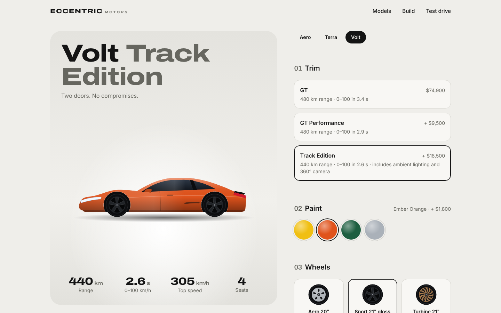

# Eccentric Motors · Car configurator

A full-stack car configurator for a made-up electric car brand. Pick a model, trim, paint, wheels and options; the server prices the build as you click; save it as a short shareable code; then book a test drive at a showroom with live slot availability.

**Live:** https://rahul-singh-project-assignment-car-showcase.vercel.app (the API is on a free tier, so the first load can take up to a minute)



## What it does

- **Live configurator.** The cars are drawn as SVG, not photos, so the paint colour and wheel style change on the actual car with a smooth transition. Specs (range, 0–100, top speed) update with the trim.
- **Server-side pricing.** The browser sends the chosen options and the API returns line items and a total. It checks that every option belongs to that model, ignores any price the client sends, and handles packages that come free with a trim.
- **The URL is the state.** `/build/volt?trim=track&color=ember&wheels=sport` reloads to the same car, so back, refresh and copy-paste all work.
- **Shareable builds.** Saving stores the build with its quote and returns a 6-character code (no look-alike characters such as 0/O or 1/I). Share links also carry the configuration, so a link still works if the demo database has been reset.
- **Test-drive booking.** Showrooms, bookable days (tomorrow to 30 days ahead, closed Sundays, in the showrooms' time zone) and times with live availability. Each slot has two demo cars. A unique index on `(showroom, date, time, car)` means two people racing for the last car can't both get it, and a second index allows one booking per person per day. The confirmation can be added to a calendar (`.ics`).
- **Details that matter.** Per-IP rate limits on writes, input validation, friendly error messages, a notice while the free server wakes up, labelled controls that work with a keyboard, reduced-motion support, and a mobile layout with a sticky price bar.

## Stack

| | |
|---|---|
| Frontend | React 19, Vite, Tailwind CSS 4, Framer Motion, Zustand, React Router |
| Backend | Node.js, Express 5, Mongoose 8, MongoDB |
| Tests | `node:test` + Supertest against an in-memory MongoDB (16 tests) |
| Hosting | Vercel (frontend, proxies `/api`) and Render (API) |

## Run it locally

```bash
# API on http://localhost:5000
cd backend
npm install
npm run dev        # no MONGODB_URI? it starts an in-memory MongoDB
npm test

# Frontend on http://localhost:5173 (proxies /api to the API)
cd frontend/eccentric-frontend
npm install
npm run dev
```

To keep data between restarts, copy `backend/.env.example` to `backend/.env` and set `MONGODB_URI`.

## API

| Method | Path | |
|---|---|---|
| `GET` | `/api/models` | All models with trims, colours and wheels |
| `GET` | `/api/models/:slug` | One model |
| `GET` | `/api/packages` | Optional extras |
| `POST` | `/api/quote` | `{ model, trim, color, wheels, packages[] }` → line items and total |
| `POST` | `/api/builds` | Save a configuration → `{ code, quote }` |
| `GET` | `/api/builds/:code` | Load a saved build |
| `GET` | `/api/test-drives/options` | Showrooms, bookable dates and times |
| `GET` | `/api/test-drives/availability?location=&date=` | Cars left in each time slot |
| `POST` | `/api/test-drives` | `{ name, email, model, location, date, slot, buildCode? }` → booking reference |

## Project layout

```
backend/
  src/data/catalog.js      models, prices and booking rules (seeded on start)
  src/services/pricing.js  the only place prices are worked out
  src/services/schedule.js bookable days in the showroom time zone
  src/models/              Mongoose schemas (unique indexes for bookings)
  src/app.js               routes
  tests/                   API tests
frontend/eccentric-frontend/
  src/components/CarArt.jsx  the SVG cars and wheels
  src/pages/                 Home, Configurator, SavedBuild, TestDrive, NotFound
```

Eccentric Motors is fictional; feature photos are used for illustration only.

## License

MIT © Rahul Singh
